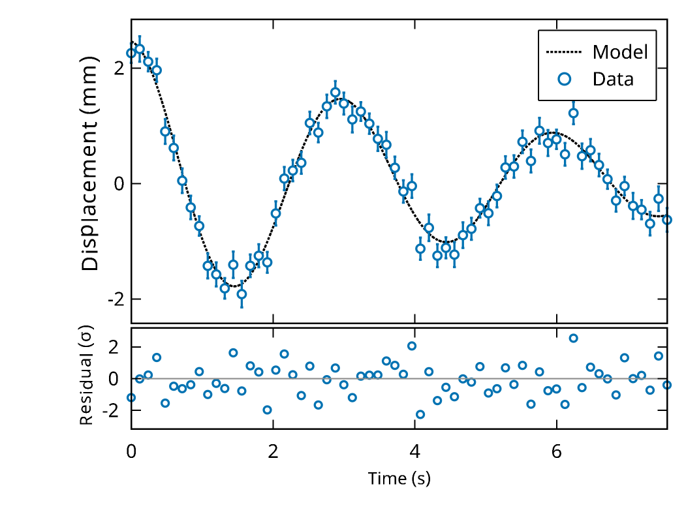
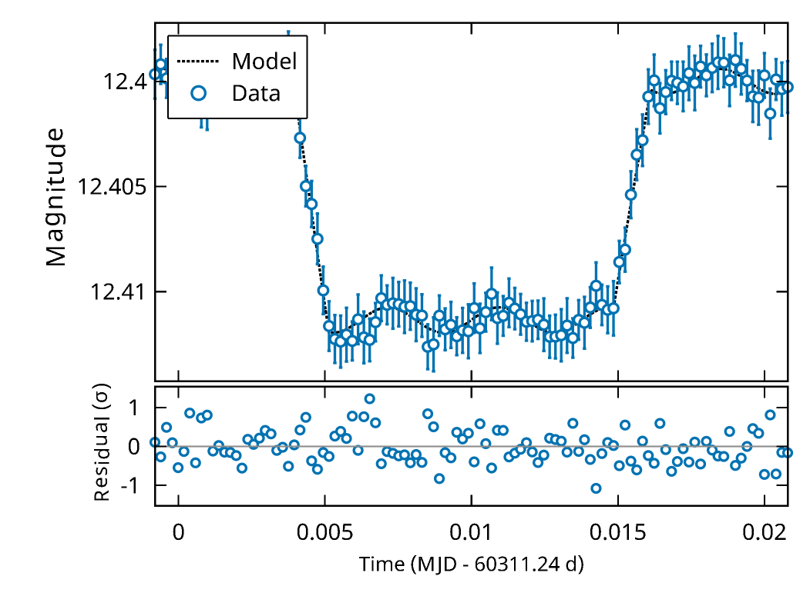
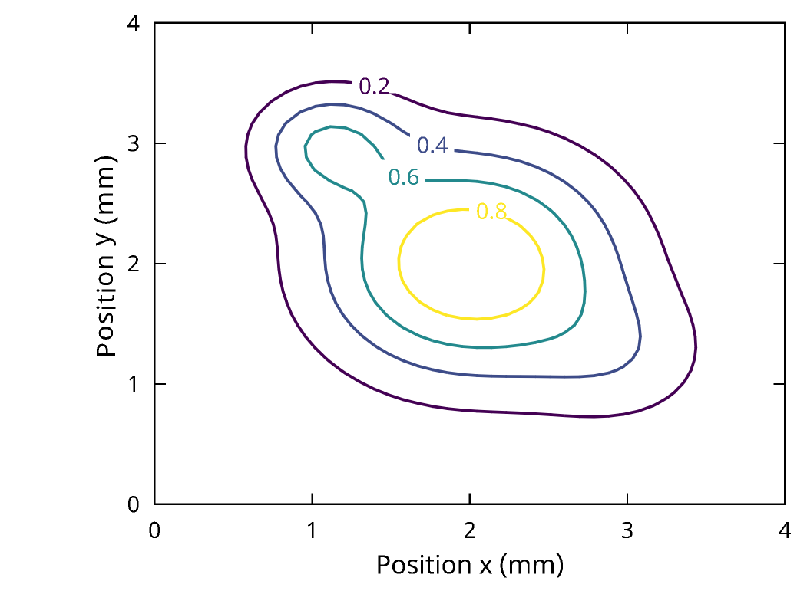
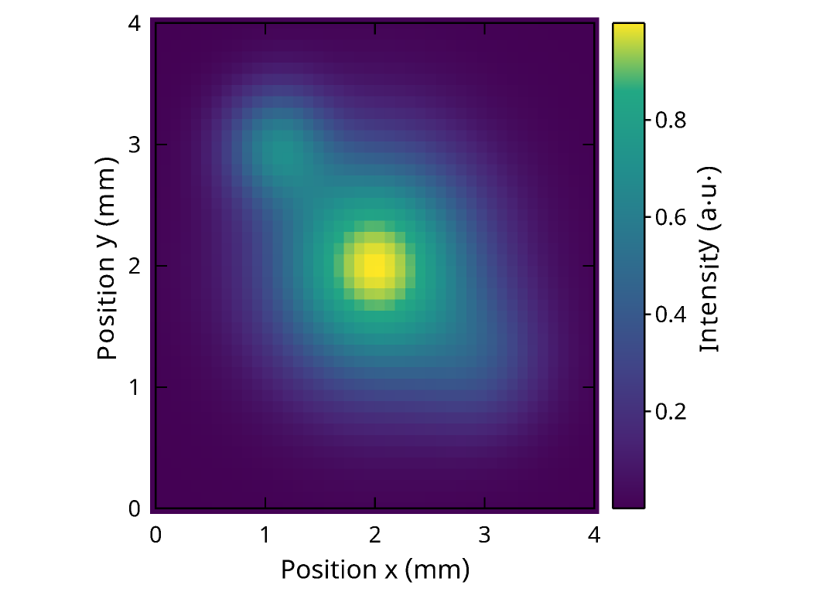
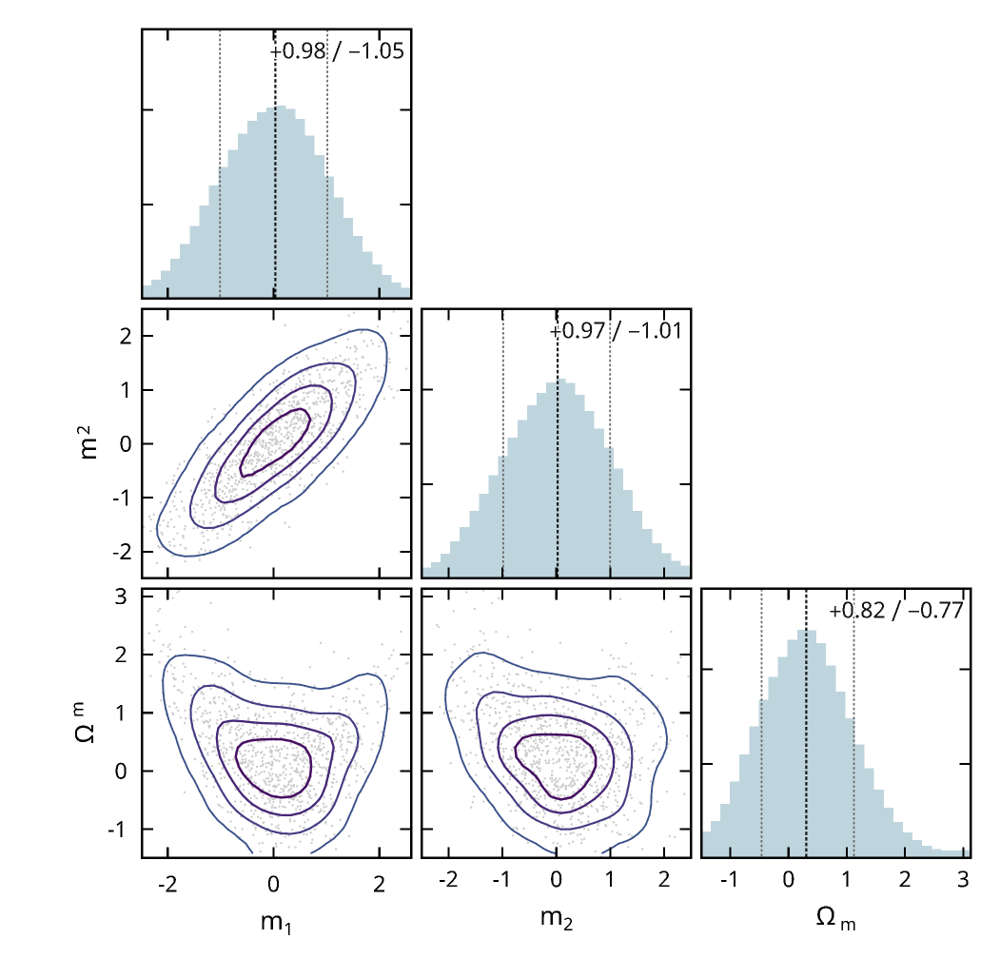
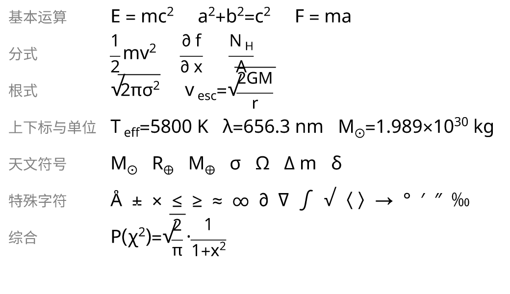

# scifig — 科研出版级图表（Nature / Science 规范）

纯 Python（标准库 + fontTools）本地渲染，**不需要 numpy / matplotlib / PIL / cairo**。
面向「能直接投稿的数据图」：轴标题带物理量与单位、误差棒、对数轴、残差子图、
光变曲线、热图、等高线、corner plot、天图投影、公式排版、**SVG/PDF 矢量输出**，
出图自动跑合规检查。也支持中文教学插图档（150 × 92 mm @300 dpi）。

## 示例

<table>
  <tr>
    <td align="center"><br>数据 + 模型拟合 + 残差子图</td>
    <td align="center"><br>光变曲线（误差棒 + 模型）</td>
  </tr>
  <tr>
    <td align="center"><br>等高线（带数值标签）</td>
    <td align="center"><br>二维热图 + colorbar</td>
  </tr>
  <tr>
    <td align="center"><br>MCMC 后验角图（corner plot）</td>
    <td align="center"><br>数学公式排版（上下标 / 分式 / 根式 / 希腊字母）</td>
  </tr>
</table>

## 目录

```
SKILL.md                 给 AI agent 的说明书（frontmatter + 用法）
README.md
LICENSE
requirements.txt         fonttools
scripts/
  sciplot.py             入口：Figure / figure_fit / figure_lightcurve /
                         plot_series / plot_heatmap / plot_contour /
                         plot_scatter_c / colorbar
  raster.py              光栅引擎（Canvas + 字形填充 + zlib PNG）
  sci/
    fonts.py             字体发现、回退链、文本度量（含复合字形展开）
    mathtext.py          $...$ 数学排版：上下标/分式/根式/矩阵/分段函数/希腊字母
    palettes.py          Okabe-Ito / viridis / cividis
    style.py             期刊 profile、mm↔px 换算、合规检查器
    primitives.py        图元（线/虚线/标记/误差棒/置信带/箭头/文字描边）
    axes.py              坐标轴系统（四面框/主次刻度/log/反转/轴标题/图例/多面板）
    contour.py           等高线（marching squares，纯 Python）
    vector.py            矢量出口（SVG 1.1 / PDF 1.4，文字转路径、不嵌字体）
    corner.py            MCMC 后验角图（corner plot）
    skymap.py            RA/Dec 天图投影（sinusoidal / mollweide / rect）
examples/
  demo.py                fit + lightcurve 样例
  demo_math.py           公式 / 特殊字符 / 颜色样例
  demo_2d.py             热图 / 等高线 / 第三维着色样例
  *.png                  对应成图
tests/
  smoke.py               冒烟测试（20 点折线图 → PNG）
```

## 依赖与安装

- Python 3.10+
- `fontTools`：`pip install -r requirements.txt`（或 `pip install fonttools`）
- 字体：Noto Sans Math、Noto Sans CJK（简体）、DejaVu Math TeX Gyre 等。
  程序会自动探测常见系统字体目录；也可用环境变量 `SCI_FONT_DIR` 指向字体目录
  （多个目录用 `os.pathsep` 分隔）。

不需要改任何源码里的路径。把 `scripts/` 加进 `sys.path` 即可：

```python
import sys
sys.path.insert(0, "/path/to/scifig/scripts")
from sciplot import Figure, figure_fit, figure_lightcurve, plot_series
```

## 用法

```python
# 一行出图
figure_lightcurve(time=mjd, mag=mag, err=err, model=(mjdm, magm), out="lc.png")
figure_fit(x=x, y=y, yerr=err, model=(xm, ym),
           xlabel=r"$T$ (K)", ylabel=r"$\sigma$ (mK)", out="fit.png")
```

复杂图自行搭：

```python
fig = Figure(profile="nature", size="single")
ax = fig.axes(xlim=(0, 10), ylim=(0, 1),
              xlabel="Phase", ylabel="Normalized flux")
plot_series(ax, x, y, yerr=e, marker="circle", label="Data")
plot_series(ax, x2, y2, linestyle="--", color="#D55E00", label="Model")
ax.legend([{"kind": "marker", "color": "#0072B2", "label": "Data",
            "marker": "circle", "hollow": True}], loc="upper right")
ax.draw()
fig.save("out.png")            # 自动打印合规检查
```

二维数据：

```python
from sciplot import plot_heatmap, plot_contour, plot_scatter_c
ax = fig.axes_with_colorbar(xlim=(0, 4), ylim=(0, 4), xlabel="x", ylabel="y")
vmin, vmax = plot_heatmap(ax, xs, ys, z, cmap="viridis")
plot_contour(ax, xs, ys, z, n=8, labels=True)
ax.draw()
fig.colorbar(ax, cmap="viridis", vmin=vmin, vmax=vmax, label="Intensity (a.u.)")
```

矢量输出（投稿）：

```python
fig = Figure(profile="nature", size="single", backend="svg")   # 或 "pdf"
# ... 绘图代码完全一样 ...
fig.save("figure.svg")     # 文字已转路径，不依赖目标机器字体
```

领域图种：

```python
from sci.corner import corner_figure
corner_figure(samples, ["$\\mu_0$", "$\\mu_1$", "$\\ln\\sigma$"], out="corner.png")

from sci.skymap import skymap_figure
skymap_figure(ra, dec, values=val, out="skymap.png")   # RA 自动反向
```

教学插图档（非投稿）：

```python
from sciplot import Figure
fig = Figure(profile="nature", size="double", width_mm=150, height_mm=92)
```

## 测试

```bash
python tests/smoke.py
```

冒烟测试不依赖任何外部数据：手造 20 个点画折线图，保存 PNG，
断言文件存在且大于 1 KB。示例图也可以直接跑：

```bash
python examples/demo.py       # 输出到 examples/out/
python examples/demo_2d.py
python examples/demo_math.py
```

## 内置规范（Nature / Science）

| 项 | Nature | Science |
|---|---|---|
| 单栏 / 双栏宽 | 89 mm / 183 mm | 90 mm / 184 mm |
| 图内字号 | 5–7 pt（面板 8 pt） | ≥6 pt（轴标签 8 pt、面板 9 pt） |
| 最小线宽 | — | 0.28 pt |
| 光栅 | ≥300 dpi | ≥300 dpi |
| 禁止 | 背景网格、阴影、装饰、彩色文字 | 只收 RGB、避免红+绿 |

合规检查器会检查：光栅宽 ≥1000 px、字号/线宽下限、轴标题缺失、jet 色板、
「多条曲线仅靠颜色区分」、「红绿并置」、背景网格、柱状图 y 轴截断。

## 已知限制

- 公式支持单行 + 分式/根式/矩阵/分段函数；**不支持**多行对齐（align）、积分上下堆叠
- 热图格子建议 ≤120×120（纯 Python 逐格填充；更大的规则网格走快速路径）
- 无 3D、无透明通道（半透明用混色近似）
- PDF 为单页；多页文档请拼接
- 字体固定 sans-serif（Noto Sans 系列），可用 `SCI_FONT_DIR` 指定字体目录

## 许可

MIT，见 [LICENSE](LICENSE)。Copyright (c) 2026 KongBai-lab。
随附字体不随包分发（使用系统字体）。
